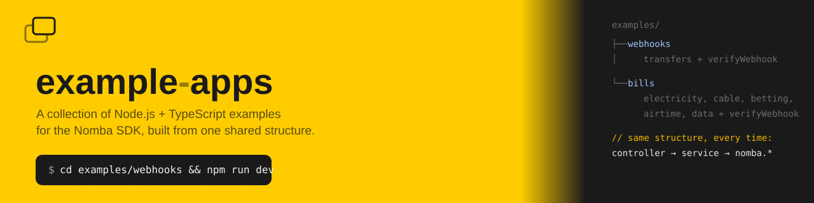

# Example Apps

Small, self-contained Express + TypeScript servers demonstrating the
[`@nomba/node-sdk`](https://developer.nomba.com). Each example under
`examples/` is its own standalone app — own `package.json`, own
dependencies, own `.env`, own local SQLite database — built from the same
structure (controller → service layers, validated env config, a shared
NestJS-style logger, `verifyWebhook`-based webhook handling,
[drizzle-orm](https://orm.drizzle.team) + `node:sqlite` persistence) so that
once you've read one, the others are immediately familiar.

## Examples

| Example | What it covers |
| --- | --- |
| [`examples/webhooks`](examples/webhooks) | Bank transfers (lookup → initiate → requery) and verifying/handling the webhooks Nomba sends back about them |
| [`examples/bills`](examples/bills) | Electricity, cable TV, betting, airtime and data billers (lookup → pay → requery), a cross-biller customer subscription-history lookup, and the same webhook handling applied to bill payments |
| [`examples/payments`](examples/payments) | Virtual accounts, hosted checkout, direct debit mandates, and saved-card payment methods, plus the same webhook handling applied to payments and checkout |

Each example has its own README with full setup, API reference and
troubleshooting; `examples/webhooks` additionally has a
[`docs/walkthrough.md`](examples/webhooks/docs/walkthrough.md) with a
file-by-file explanation of the shared structure and a full request trace
through every layer — worth reading first regardless of which example you're
actually working from, since both follow it.

## Running an example

```bash
cd examples/webhooks   # or examples/bills
npm install
cp .env.example .env   # fill in your Nomba sandbox credentials
npm run dev
```

Requires **Node.js 24+** — every example runs its `.ts` files directly via
Node's native TypeScript support, with no build step and no `ts-node`/`tsx`.

## Adding another example

Copy an existing example's structure rather than starting from scratch:
`src/main.ts` → `app.setup.ts` → `config/env.config.ts` →
`common/` (logger, response envelopes, zod-validation middleware, outcome
hooks) → `modules/<domain>/` (controller + service) and `modules/webhooks/`
if the new example also needs webhook handling. The domain-agnostic files
under `common/` and `modules/nomba.ts` can be copied verbatim; only the
domain module and the route table in `app.setup.ts` actually change.

`src/database/client.ts` (opens the db, runs migrations on import) and
`drizzle.config.ts` can also be copied verbatim — only `src/database/schema.ts`
is domain-specific, since its tables mirror the new example's own resources.
After writing it, run `npm install` then `npm run db:generate` once to
produce the initial migration in `src/database/migrations/`, and check it
into the repo.
