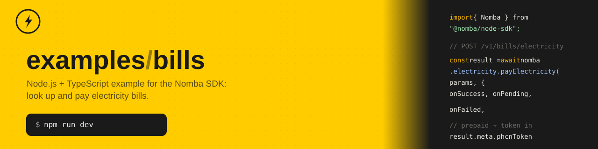

# examples/bills

A small Express + TypeScript server for exercising the [`@nomba/node-sdk`](https://developer.nomba.com):
it looks up and pays electricity, cable TV, betting, airtime and data bills,
looks up a customer's previous bill payments, and receives, verifies, and
handles the asynchronous webhooks Nomba sends back about those payments
(success, pending, failed, etc).

This is the same app structure as [`examples/webhooks`](../webhooks) — same
layers (controller → service), same env validation, same logger, same
webhook-verification approach — applied to the bills side of the SDK instead
of transfers. If you've read that example's
[`docs/walkthrough.md`](../webhooks/docs/walkthrough.md), everything below
about *how* the code is organized will already be familiar; this README
covers what's specific to bills.

## Requirements

- **Node.js 24+** — the app runs `.ts` files directly; there is no build step.
  TypeScript is stripped at runtime by Node itself, so no `ts-node`/`tsx` is
  needed. Check with `node --version`.
- A **Nomba sandbox account** with API credentials (account ID, client ID,
  client secret, and a webhook signature key).
- A **public URL** if you want Nomba to actually deliver webhooks to this
  server (e.g. [ngrok](https://ngrok.com) or [cloudflared](https://developers.cloudflare.com/cloudflare-one/connections/connect-networks/))
  — Nomba can't reach `localhost`.

## Setup

1. Install dependencies:

   ```bash
   npm install
   ```

2. Copy the env template and fill in your sandbox credentials:

   ```bash
   cp .env.example .env
   ```

   | Variable | Required | Default | Description |
   | --- | --- | --- | --- |
   | `PORT` | no | `43903` | Port the HTTP server listens on |
   | `NOMBA_ACCOUNT_ID` | yes | — | Your Nomba parent account ID |
   | `NOMBA_CLIENT_ID` | yes | — | API client ID |
   | `NOMBA_CLIENT_SECRET` | yes | — | API client secret |
   | `NOMBA_ENVIRONMENT` | no | `sandbox` | `sandbox` or `production` — must match your credentials |
   | `NOMBA_WEBHOOK_SECRET` | yes | — | The signature key configured on your webhook subscription; used to verify incoming webhooks |
   | `DATABASE_PATH` | no | `./bills.db` | Where the local SQLite database file is created — see [Database](#database) |

   Every variable is validated at boot (via `zod` in `src/config/env.config.ts`):
   a missing or malformed value crashes the process immediately with a clear
   error instead of failing later, mid-request.

3. Start the server:

   ```bash
   npm run dev     # restarts on file change (node --watch)
   npm start       # single run, no watch
   ```

On boot the server prints every registered route:

```
[ExampleServer] 12345  - 11/12/2026, 12:00:00 PM     LOG [Bootstrap] Server is running on port 43903
[ExampleServer] 12345  - 11/12/2026, 12:00:00 PM     LOG [Bootstrap] Available routes:
[ExampleServer] 12345  - 11/12/2026, 12:00:00 PM     LOG [Bootstrap]   GET /v1/bills/electricity/providers
[ExampleServer] 12345  - 11/12/2026, 12:00:00 PM     LOG [Bootstrap]   POST /v1/bills/electricity/lookup-meter
[ExampleServer] 12345  - 11/12/2026, 12:00:00 PM     LOG [Bootstrap]   POST /v1/bills/electricity
[ExampleServer] 12345  - 11/12/2026, 12:00:00 PM     LOG [Bootstrap]   GET /v1/bills/electricity/:billId
[ExampleServer] 12345  - 11/12/2026, 12:00:00 PM     LOG [Bootstrap]   GET /v1/bills/cable/plans
[ExampleServer] 12345  - 11/12/2026, 12:00:00 PM     LOG [Bootstrap]   POST /v1/bills/cable/lookup-customer
[ExampleServer] 12345  - 11/12/2026, 12:00:00 PM     LOG [Bootstrap]   POST /v1/bills/cable
[ExampleServer] 12345  - 11/12/2026, 12:00:00 PM     LOG [Bootstrap]   GET /v1/bills/betting/providers
[ExampleServer] 12345  - 11/12/2026, 12:00:00 PM     LOG [Bootstrap]   POST /v1/bills/betting/lookup-customer
[ExampleServer] 12345  - 11/12/2026, 12:00:00 PM     LOG [Bootstrap]   POST /v1/bills/betting
[ExampleServer] 12345  - 11/12/2026, 12:00:00 PM     LOG [Bootstrap]   POST /v1/bills/airtime
[ExampleServer] 12345  - 11/12/2026, 12:00:00 PM     LOG [Bootstrap]   GET /v1/bills/data/plans/:network
[ExampleServer] 12345  - 11/12/2026, 12:00:00 PM     LOG [Bootstrap]   POST /v1/bills/data
[ExampleServer] 12345  - 11/12/2026, 12:00:00 PM     LOG [Bootstrap]   GET /v1/bills/customers/:customerId/subscriptions
[ExampleServer] 12345  - 11/12/2026, 12:00:00 PM     LOG [Bootstrap]   POST /v1/webhooks/nomba
```

4. Verify everything typechecks (recommended before committing):

   ```bash
   npm run typecheck
   ```

Note the default `PORT` (`43903`) differs from `examples/webhooks`'s
(`43902`), so you can run both examples side by side without a collision.

## Scripts

| Command | What it does |
| --- | --- |
| `npm start` | Runs the server once (`node --env-file=.env src/main.ts`) |
| `npm run dev` | Same, but restarts on file changes (`node --watch`) |
| `npm run typecheck` | Runs `tsc --noEmit` to check types without compiling |
| `npm run db:generate` | Regenerates the SQL migration in `src/database/migrations/` after editing `src/database/schema.ts` — not needed just to run the app |

## Database

Every bill payment gets a row in a local SQLite database (`DATABASE_PATH`,
default `./bills.db`), via [drizzle-orm](https://orm.drizzle.team) on top of
Node's built-in `node:sqlite` — no native dependency, no build step,
matching the rest of this app. Everything related to it lives under
`src/database/`:

- `schema.ts` — two tables: `bill_payments`, shared by every biller and
  discriminated by a `billerType` column (`electricity`/`cable`/`betting`/
  `airtime`/`data`). `reference` is the `merchantTxRef` you chose,
  `transactionId` is Nomba's own id once known, plus `status` and
  `requestPayload`/`responsePayload` as JSON — and `webhook_deliveries`
  (every webhook delivery, see below).
- `client.ts` — opens the database and runs any pending migrations from
  `migrations/` on import, so tables exist before the first request. Safe to
  run on every boot.
- `migrations/` — SQL generated by `npm run db:generate`, checked into the
  repo so `npm install && npm run dev` works with no extra step.

**When rows get written:**

- Each `payXBill`/`buyAirtime`/`buyData` call inserts a row once its SDK call
  resolves — the three outcome hooks in
  [`src/common/bill.hooks.ts`](src/common/bill.hooks.ts) (the same
  `TODO`-marked extension point mentioned under
  [Bill payment outcomes](#bill-payment-outcomes)) now persist instead of
  only logging. Every biller's result always includes `id`, even when the
  status is `PENDING_BILLING`, so `onPendingHook` captures it as
  `transactionId` too — skipping that would leave the pending row without
  one, which the later webhook (matched by `transactionId`) would then miss,
  inserting a duplicate instead of updating it.
- `getBillDetails` refreshes that row with whatever the requery call returns.
- `handleWebhookEvent` updates the `bill_payments` row by `transactionId`
  when a webhook arrives — or inserts one if there wasn't a prior local row,
  so nothing delivered is ever dropped.

**Every webhook delivery is also logged**, independent of whether it matched
a bill payment: `handleWebhook` in
[`webhook.controller.ts`](src/modules/webhooks/webhook.controller.ts) writes
a `webhook_deliveries` row for every request — accepted or rejected — via
`logDelivery` in
[`webhook.service.ts`](src/modules/webhooks/webhook.service.ts), *before*
checking the signature, so a rejected delivery (`signatureValid: false`,
`status: 'rejected'`) still leaves a durable record of exactly what was
sent, not just a console line that's lost on restart. Once accepted, the row
is marked `status: 'processed'` after `handleWebhookEvent` runs, or
`status: 'failed'` (with the error message) if it throws.

This is deliberately decoupled from the `bill_payments` table: it's designed
so a future **processor** — a separate worker, cron job, or queue consumer —
could poll `webhook_deliveries` for `status = 'received'` rows and apply
them to `bill_payments` asynchronously, instead of (or alongside) today's
synchronous call inside the request. No code here does that yet; the schema
and status lifecycle just leave room for it without a later migration.

Note: `drizzle-orm`'s `node:sqlite` driver only exists in the `1.0.0-rc.5`
prerelease line as of this writing (the stable `0.45.x` release has no
`node:sqlite` driver yet) — this app pins both `drizzle-orm` and
`drizzle-kit` to that exact version for that reason.

## API reference

All routes are mounted under the `/v1` prefix. Five billers are covered —
electricity, cable TV, betting, airtime and data — plus one endpoint that
looks across all of them for a given customer.

Electricity, cable and betting share the same shape: **list providers →
look up the customer (validate before paying) → pay**. Airtime has no lookup
step — there's nothing to validate ahead of a plain phone-number top-up.
Data looks up *plans* (by network) rather than a customer, since a data
purchase targets a plan (`productId`), not an amount.

### `GET /v1/bills/electricity/providers`

Lists the electricity distribution companies (discos) available for meter
lookup and payment.

```bash
curl http://localhost:43903/v1/bills/electricity/providers
```

### `POST /v1/bills/electricity/lookup-meter`

Resolves a meter/customer ID to the customer's name. Always call this before
paying to confirm the meter is valid.

```bash
curl -X POST http://localhost:43903/v1/bills/electricity/lookup-meter \
  -H "Content-Type: application/json" \
  -d '{"disco": "ikeja-electric", "customerId": "1234567890"}'
```

| Field | Type | Rule |
| --- | --- | --- |
| `disco` | string | required — from `GET /v1/bills/electricity/providers` |
| `customerId` | string | required — the meter number |

### `POST /v1/bills/electricity`

Pays an electricity bill.

```bash
curl -X POST http://localhost:43903/v1/bills/electricity \
  -H "Content-Type: application/json" \
  -d '{
    "disco": "ikeja-electric",
    "customerId": "1234567890",
    "amount": 5000,
    "payerName": "Jane Doe",
    "meterType": "PREPAID",
    "merchantTxRef": "bill-001"
  }'
```

| Field | Type | Rule |
| --- | --- | --- |
| `disco` | string | required — from the providers list |
| `customerId` | string | required — the meter number |
| `amount` | number | positive |
| `payerName` | string | required |
| `meterType` | string | usually `PREPAID` or `POSTPAID` |
| `merchantTxRef` | string | required — your idempotency key. Reuse the same value when retrying a *pending* payment; use a new one only after a payment has definitively failed. |

The response is whatever the SDK's outcome resolves to (see
[Bill payment outcomes](#bill-payment-outcomes) below). For a successful
prepaid payment, the vend token is in `data.meta.phcnToken`.

### `GET /v1/bills/electricity/:billId`

Looks up a bill payment's current status by the `merchantTxRef` you gave it
at creation (there's no separate "bill ID" — this app doesn't have a list
endpoint either, since the SDK has none to back it).

```bash
curl http://localhost:43903/v1/bills/electricity/bill-001
```

### `GET /v1/bills/cable/plans`

Lists a cable TV provider's subscription plans (bouquets) and prices.

```bash
curl "http://localhost:43903/v1/bills/cable/plans?cableTvType=dstv"
```

| Query param | Type | Rule |
| --- | --- | --- |
| `cableTvType` | string | required — e.g. `dstv`, `gotv`, `startimes`, `ShowMax` |

### `POST /v1/bills/cable/lookup-customer`

Resolves a smartcard number to the customer's account name.

```bash
curl -X POST http://localhost:43903/v1/bills/cable/lookup-customer \
  -H "Content-Type: application/json" \
  -d '{"cableTvType": "dstv", "customerId": "1234567890"}'
```

### `POST /v1/bills/cable`

Pays a cable TV subscription.

```bash
curl -X POST http://localhost:43903/v1/bills/cable \
  -H "Content-Type: application/json" \
  -d '{
    "cableTvType": "dstv",
    "customerId": "1234567890",
    "amount": 10500,
    "payerName": "Jane Doe",
    "merchantTxRef": "cable-001"
  }'
```

### `GET /v1/bills/betting/providers`

Lists the supported betting providers.

```bash
curl http://localhost:43903/v1/bills/betting/providers
```

### `POST /v1/bills/betting/lookup-customer`

Resolves a betting account/customer ID to the account name.

```bash
curl -X POST http://localhost:43903/v1/bills/betting/lookup-customer \
  -H "Content-Type: application/json" \
  -d '{"bettingProvider": "bet9ja", "customerId": "1234567"}'
```

### `POST /v1/bills/betting`

Funds a betting wallet.

```bash
curl -X POST http://localhost:43903/v1/bills/betting \
  -H "Content-Type: application/json" \
  -d '{
    "bettingProvider": "bet9ja",
    "customerId": "1234567",
    "phoneNumber": "08012345678",
    "amount": 2000,
    "payerName": "Jane Doe",
    "merchantTxRef": "bet-001"
  }'
```

### `POST /v1/bills/airtime`

Tops up a phone number directly — no lookup step.

```bash
curl -X POST http://localhost:43903/v1/bills/airtime \
  -H "Content-Type: application/json" \
  -d '{
    "phoneNumber": "08012345678",
    "network": "MTN",
    "amount": 500,
    "merchantTxRef": "airtime-001"
  }'
```

| Field | Type | Rule |
| --- | --- | --- |
| `phoneNumber` | string | 11–13 characters |
| `network` | string | `MTN`, `GLO`, `AIRTEL`, or `9MOBILE` (case-insensitive) |
| `amount` | number | positive |
| `merchantTxRef` | string | required — idempotency key |
| `senderName` | string | optional |

### `GET /v1/bills/data/plans/:network`

Lists the data bundles available for a network.

```bash
curl http://localhost:43903/v1/bills/data/plans/mtn
```

### `POST /v1/bills/data`

Buys a data bundle. Unlike the other billers, this takes a `productId` from
the plans list rather than a free-form `amount` — buying by amount directly
is deprecated on Nomba's side.

```bash
curl -X POST http://localhost:43903/v1/bills/data \
  -H "Content-Type: application/json" \
  -d '{
    "productId": "mtn1",
    "phoneNumber": "08012345678",
    "network": "MTN",
    "merchantTxRef": "data-001"
  }'
```

### `GET /v1/bills/customers/:customerId/subscriptions`

Looks up a customer's previous bill payments — the meter number, smartcard
number, betting account or phone number a payment went to
(`customerBillerId` on the transaction) — across electricity, cable, betting,
airtime and data alike.

```bash
curl http://localhost:43903/v1/bills/customers/1234567890/subscriptions
```

**There's no dedicated "customer history" endpoint on the SDK for this.**
[`bill.service.ts`](src/modules/bills/bill.service.ts)'s
`getCustomerSubscriptionHistory` demonstrates the only way to get it today:
walk the parent account's transactions (`nomba.transactions.iterateParentTransactions()`)
and match on `customerBillerId` client-side, capped at a fixed number of
scanned transactions (`SCAN_LIMIT`) so one lookup can't run away paging
through an account's entire history. That cap is a real ceiling, not a
nicety — a customer whose most recent matching bill is older than the scan
window won't be found. For anything beyond a demo, keep your own index of
payments by customer (e.g. in a database written to from the webhook
handler) rather than scanning Nomba's transaction list on every lookup.

### `POST /v1/webhooks/nomba`

Where Nomba delivers webhook events. Not meant to be called directly — see
[Webhooks](#webhooks) below.

Every successful response is wrapped the same way:

```json
{
  "message": "Request successful",
  "timestamp": "2026-11-12T12:00:00.000Z",
  "status": "success",
  "data": { "...": "..." }
}
```

and every error the same way, with a status code that matches the failure
(`400` for a bad request body, `401` for a bad webhook signature, `500` for
anything unexpected):

```json
{
  "message": "Something went wrong",
  "timestamp": "2026-11-12T12:00:00.000Z",
  "path": "/v1/bills/electricity",
  "method": "POST",
  "error": { "message": "...", "stack": "..." }
}
```

## Bill payment outcomes

Every money-moving call the SDK makes resolves to exactly one of three
outcomes, and this app's handlers for them live in
[`src/common/bill.hooks.ts`](src/common/bill.hooks.ts):

| Outcome | Meaning | What this app currently does |
| --- | --- | --- |
| `success` | Done | Logs it and returns the result |
| `pending` | Not final — still processing, or an undocumented code | Logs it; **wait for the webhook or requery, never retry under a new reference** |
| `failed` | A definite rejection | Logs a warning |

Those hooks only log today — the `TODO` in that file is where you'd plug in
persistence, notifications, or a requery job.

## Webhooks

`POST /v1/webhooks/nomba` verifies the `nomba-signature`/`nomba-timestamp`
headers against `NOMBA_WEBHOOK_SECRET` before doing anything else, using the
SDK's `verifyWebhook`. An invalid signature gets a `401` and the event is
never processed. A valid one is handed to
[`src/modules/webhooks/webhook.service.ts`](src/modules/webhooks/webhook.service.ts),
which currently just logs the event type — same `TODO` situation as the bill
hooks. Bill payments fire `payment_success`/`payment_failed` (as opposed to
transfers' `payout_*` events).

**Important:** this route needs the *raw* request body (bytes exactly as
Nomba signed them) to verify correctly, so it's mounted behind
`express.raw()` instead of the app's normal `express.json()` — see
`src/app.setup.ts`, or the webhooks example's walkthrough doc for why.

To receive real webhooks locally:

1. Start a tunnel: `ngrok http 43903` (or your configured `PORT`).
2. In the Nomba dashboard, under **Developer → Webhook Setup**, set the URL
   to `https://<your-tunnel-domain>/v1/webhooks/nomba`, and set the
   signature key to the same value as your `NOMBA_WEBHOOK_SECRET`.
3. Subscribe to `payment_success` and `payment_failed`.

Nomba retries failed/missed deliveries on its own, and also exposes
`nomba.webhooks.eventLogs()` / `repush()` / `replay()` on the SDK if you need
to inspect or manually resend what was delivered — this app doesn't expose
those as routes, but they're available wherever `../nomba.ts`'s client is
imported.

## Project structure

```
drizzle.config.ts                 # points drizzle-kit generate at src/database/
src/
├── main.ts                       # entry point
├── app.setup.ts                  # Express app: middleware + route table
├── config/
│   └── env.config.ts             # validated environment variables
├── database/
│   ├── schema.ts                 # drizzle table definitions (bill_payments)
│   ├── client.ts                 # opens the db, runs migrations on import
│   └── migrations/                # generated SQL, checked into the repo
├── common/                       # cross-cutting code
│   ├── logger.ts                 # Nest-style console logger
│   ├── request.logger.ts         # logs every request's method/path/status/duration
│   ├── interceptor.response.ts   # shared success/error JSON envelopes
│   ├── validator.request.ts      # zod-validation middleware factory
│   └── bill.hooks.ts             # success/pending/failed handlers, shared by every biller, now persisting too
└── modules/                      # one folder per domain
    ├── nomba.ts                  # the shared, configured SDK client
    ├── bills/
    │   ├── bill.controller.ts
    │   └── bill.service.ts
    └── webhooks/
        ├── webhook.controller.ts
        └── webhook.service.ts
```

Each module follows a **controller → service** split: controllers only know
about `req`/`res`, services only know about the Nomba SDK — identical
reasoning to `examples/webhooks`. See that example's
[`docs/walkthrough.md`](../webhooks/docs/walkthrough.md) for the full
file-by-file explanation and a request trace through every layer; swap
"transfer" for "bill" and it applies here unchanged.

## Logging

Console output is formatted to look like NestJS's default logger (colored
level, pid, timestamp, `[Context]` tag) via the small, dependency-free
`Logger` class in `src/common/logger.ts`. The global error-handling
middleware in `app.setup.ts` logs every unhandled error server-side
(method, path, message, and stack trace) before responding to the client.

Two more things get logged automatically:

- **Every request's timing.** `src/common/request.logger.ts` is mounted
  first in `app.setup.ts`, ahead of the webhook route's raw-body parsing, so
  it wraps every request including `/health` and the webhook endpoint. It
  logs `METHOD url statusCode durationMs` once the response finishes, e.g.
  `[HTTP] POST /v1/webhooks/nomba 200 1.8ms`.
- **The raw webhook payload.** `handleWebhook` in
  `webhook.controller.ts` logs the exact bytes Nomba sent, tagged
  `[Webhook]`, *before* checking the signature — so a rejected delivery
  still leaves a record of what was sent and why it failed.

## Troubleshooting

| Symptom | Likely cause |
| --- | --- |
| Crash on boot with a Zod error | A required env var is missing — check `.env` against the table above |
| `TokenError` on any `/v1/bills/*` call | Wrong credentials, or `NOMBA_ENVIRONMENT` doesn't match the credential pair (sandbox vs. production) |
| Webhook always gets `401` | The dashboard's signature key and `NOMBA_WEBHOOK_SECRET` don't match, or you restarted the server after changing `.env` without it picking up the new value |
| Webhook never arrives | Check the tunnel is still running and the dashboard URL still points at the current tunnel domain (ngrok's free URLs change on restart) |
| A route 404s | Remember the `/v1` prefix — routes aren't mounted at the bare path |

## License

ISC
