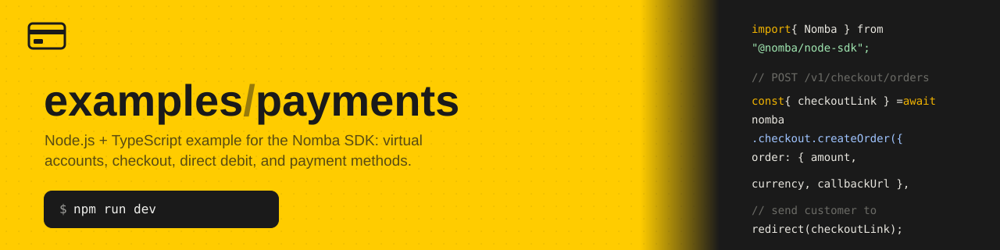

# examples/payments

A small Express + TypeScript server for exercising the [`@nomba/node-sdk`](https://developer.nomba.com)'s
four Accept Payment products: **virtual accounts**, **checkout**, **direct
debit**, and **payment methods** — plus receiving, verifying, and handling
the asynchronous webhooks Nomba sends back about those payments.

This is the same app structure as [`examples/webhooks`](../webhooks) and
[`examples/bills`](../bills) — same layers (controller → service), same env
validation, same logger, same webhook-verification approach — applied to the
accept-payment side of the SDK. If you've read
[`examples/webhooks/docs/walkthrough.md`](../webhooks/docs/walkthrough.md),
everything below about *how* the code is organized will already be familiar;
this README covers what's specific to payments.

Unlike `bills` (five billers sharing one near-identical lookup → pay → requery
shape, all in one module), these four products have genuinely different
shapes, so each gets its own module folder instead:

```
src/modules/
├── virtual-accounts/
├── checkout/
├── direct-debits/
├── payment-methods/
└── webhooks/
```

## Requirements

- **Node.js 24+** — the app runs `.ts` files directly; there is no build step.
  TypeScript is stripped at runtime by Node itself, so no `ts-node`/`tsx` is
  needed. Check with `node --version`.
- A **Nomba sandbox account** with API credentials (account ID, client ID,
  client secret, and a webhook signature key).
- A **public URL** if you want Nomba to actually deliver webhooks to this
  server (e.g. [ngrok](https://ngrok.com) or [cloudflared](https://developers.cloudflare.com/cloudflare-one/connections/connect-networks/))
  — Nomba can't reach `localhost`.

## Setup

1. Install dependencies:

   ```bash
   npm install
   ```

2. Copy the env template and fill in your sandbox credentials:

   ```bash
   cp .env.example .env
   ```

   | Variable | Required | Default | Description |
   | --- | --- | --- | --- |
   | `PORT` | no | `43904` | Port the HTTP server listens on |
   | `NOMBA_ACCOUNT_ID` | yes | — | Your Nomba parent account ID |
   | `NOMBA_CLIENT_ID` | yes | — | API client ID |
   | `NOMBA_CLIENT_SECRET` | yes | — | API client secret |
   | `NOMBA_ENVIRONMENT` | no | `sandbox` | `sandbox` or `production` — must match your credentials |
   | `NOMBA_WEBHOOK_SECRET` | yes | — | The signature key configured on your webhook subscription; used to verify incoming webhooks |
   | `DATABASE_PATH` | no | `./payments.db` | Where the local SQLite database file is created — see [Database](#database) |

   Every variable is validated at boot (via `zod` in `src/config/env.config.ts`):
   a missing or malformed value crashes the process immediately with a clear
   error instead of failing later, mid-request.

3. Start the server:

   ```bash
   npm run dev     # restarts on file change (node --watch)
   npm start       # single run, no watch
   ```

On boot the server prints every registered route:

```
[ExampleServer] 12345  - 11/12/2026, 12:00:00 PM     LOG [Bootstrap] Server is running on port 43904
[ExampleServer] 12345  - 11/12/2026, 12:00:00 PM     LOG [Bootstrap] Available routes:
[ExampleServer] 12345  - 11/12/2026, 12:00:00 PM     LOG [Bootstrap]   POST /v1/virtual-accounts
[ExampleServer] 12345  - 11/12/2026, 12:00:00 PM     LOG [Bootstrap]   GET /v1/virtual-accounts/:identifier
[ExampleServer] 12345  - 11/12/2026, 12:00:00 PM     LOG [Bootstrap]   PUT /v1/virtual-accounts/:identifier
[ExampleServer] 12345  - 11/12/2026, 12:00:00 PM     LOG [Bootstrap]   DELETE /v1/virtual-accounts/:identifier
[ExampleServer] 12345  - 11/12/2026, 12:00:00 PM     LOG [Bootstrap]   POST /v1/virtual-accounts/list
[ExampleServer] 12345  - 11/12/2026, 12:00:00 PM     LOG [Bootstrap]   POST /v1/checkout/orders
[ExampleServer] 12345  - 11/12/2026, 12:00:00 PM     LOG [Bootstrap]   GET /v1/checkout/transaction
[ExampleServer] 12345  - 11/12/2026, 12:00:00 PM     LOG [Bootstrap]   POST /v1/checkout/orders/cancel
[ExampleServer] 12345  - 11/12/2026, 12:00:00 PM     LOG [Bootstrap]   POST /v1/checkout/refund
[ExampleServer] 12345  - 11/12/2026, 12:00:00 PM     LOG [Bootstrap]   POST /v1/checkout/charge-tokenized-card
[ExampleServer] 12345  - 11/12/2026, 12:00:00 PM     LOG [Bootstrap]   POST /v1/direct-debits
[ExampleServer] 12345  - 11/12/2026, 12:00:00 PM     LOG [Bootstrap]   GET /v1/direct-debits/:mandateId
[ExampleServer] 12345  - 11/12/2026, 12:00:00 PM     LOG [Bootstrap]   POST /v1/direct-debits/debit
[ExampleServer] 12345  - 11/12/2026, 12:00:00 PM     LOG [Bootstrap]   PUT /v1/direct-debits/status
[ExampleServer] 12345  - 11/12/2026, 12:00:00 PM     LOG [Bootstrap]   GET /v1/direct-debits
[ExampleServer] 12345  - 11/12/2026, 12:00:00 PM     LOG [Bootstrap]   GET /v1/payment-methods
[ExampleServer] 12345  - 11/12/2026, 12:00:00 PM     LOG [Bootstrap]   PUT /v1/payment-methods
[ExampleServer] 12345  - 11/12/2026, 12:00:00 PM     LOG [Bootstrap]   DELETE /v1/payment-methods
[ExampleServer] 12345  - 11/12/2026, 12:00:00 PM     LOG [Bootstrap]   POST /v1/webhooks/nomba
```

4. Verify everything typechecks (recommended before committing):

   ```bash
   npm run typecheck
   ```

Note the default `PORT` (`43904`) differs from `examples/webhooks`'s (`43902`)
and `examples/bills`'s (`43903`), so you can run all three examples side by
side without a collision.

## Scripts

| Command | What it does |
| --- | --- |
| `npm start` | Runs the server once (`node --env-file=.env src/main.ts`) |
| `npm run dev` | Same, but restarts on file changes (`node --watch`) |
| `npm run typecheck` | Runs `tsc --noEmit` to check types without compiling |
| `npm run db:generate` | Regenerates the SQL migration in `src/database/migrations/` after editing `src/database/schema.ts` — not needed just to run the app |

## Database

Every virtual account, checkout order, direct-debit mandate/debit, and
tokenized card gets a row in a local SQLite database (`DATABASE_PATH`,
default `./payments.db`), via [drizzle-orm](https://orm.drizzle.team) on top
of Node's built-in `node:sqlite` — no native dependency, no build step,
matching the rest of this app. Everything related to it lives under
`src/database/`:

- `schema.ts` — six tables, one per concern: `virtual_accounts`,
  `checkout_orders`, `direct_debit_mandates`, `direct_debit_debits` (one row
  per debit attempt against a mandate), `payment_methods` (a cache of
  tokenized cards), and `webhook_deliveries` (every webhook delivery, see
  below). Each of the first five uses the natural key for that resource —
  `accountRef`, `orderReference`, `merchantReference`/`mandateId`, `tokenKey`
  — plus `status` and `requestPayload`/`responsePayload` as JSON.
- `client.ts` — opens the database and runs any pending migrations from
  `migrations/` on import, so tables exist before the first request. Safe to
  run on every boot.
- `migrations/` — SQL generated by `npm run db:generate`, checked into the
  repo so `npm install && npm run dev` works with no extra step.

**When rows get written:**

- `createVirtualAccount`/`createOrder`/`createMandate`/`debitMandate` insert
  a row once their SDK call resolves; `updateVirtualAccount`/
  `expireVirtualAccount`/`cancelOrder`/`updateMandateStatus` update the
  matching row; `getVirtualAccount`/`fetchTransaction`/`getMandateStatus`
  refresh it with whatever Nomba says now.
- `refund` is the one call with outcome hooks (see
  [Checkout refund outcomes](#checkout-refund-outcomes)) — those hooks in
  [`src/common/checkout.hooks.ts`](src/common/checkout.hooks.ts) now persist
  instead of only logging, keyed by `transactionId` since a refund has no
  `orderReference` to go on.
- `listTokenizedCards` upserts every card Nomba returns into
  `payment_methods`; `deleteTokenizedCard` removes the matching local row too.
- `handleWebhookEvent` updates a `checkout_orders` row by `transactionId`
  when a webhook arrives — or inserts one if there wasn't a prior local row,
  so nothing delivered is ever dropped.

**Every webhook delivery is also logged**, independent of whether it matched
a checkout order: `handleWebhook` in
[`webhook.controller.ts`](src/modules/webhooks/webhook.controller.ts) writes
a `webhook_deliveries` row for every request — accepted or rejected — via
`logDelivery` in
[`webhook.service.ts`](src/modules/webhooks/webhook.service.ts), *before*
checking the signature, so a rejected delivery (`signatureValid: false`,
`status: 'rejected'`) still leaves a durable record of exactly what was
sent, not just a console line that's lost on restart. Once accepted, the row
is marked `status: 'processed'` after `handleWebhookEvent` runs, or
`status: 'failed'` (with the error message) if it throws.

This is deliberately decoupled from the `checkout_orders` table: it's
designed so a future **processor** — a separate worker, cron job, or queue
consumer — could poll `webhook_deliveries` for `status = 'received'` rows
and apply them to `checkout_orders` asynchronously, instead of (or
alongside) today's synchronous call inside the request. No code here does
that yet; the schema and status lifecycle just leave room for it without a
later migration.

Note: `drizzle-orm`'s `node:sqlite` driver only exists in the `1.0.0-rc.5`
prerelease line as of this writing (the stable `0.45.x` release has no
`node:sqlite` driver yet) — this app pins both `drizzle-orm` and
`drizzle-kit` to that exact version for that reason.

## API reference

All routes are mounted under the `/v1` prefix.

### Virtual accounts

A virtual account is a dedicated account number customers pay into by bank
transfer; inflows are routed to your parent account. Static accounts (no
`expiryDate`) are for repeat payments; dynamic ones (with an `expiryDate`) are
for one-off, time-bound payments.

#### `POST /v1/virtual-accounts`

Creates a virtual account.

```bash
curl -X POST http://localhost:43904/v1/virtual-accounts \
  -H "Content-Type: application/json" \
  -d '{
    "accountRef": "invoice-2026-0001-ref",
    "accountName": "Daniel Scorsese",
    "expectedAmount": 20000,
    "callbackUrl": "https://merchant.example.com/v1/webhooks/nomba"
  }'
```

| Field | Type | Rule |
| --- | --- | --- |
| `accountRef` | string | required, 16–64 characters — your reference |
| `accountName` | string | required, 8–64 characters |
| `bvn` / `nin` | string | optional; `nin` is exactly 11 digits. Defaults to the parent account's BVN if neither is given |
| `expiryDate` | string | optional, `YYYY-MM-DD HH:mm:ss`. Omit for a static (permanent) account |
| `expectedAmount` | number | optional — once set, only an exact-amount inflow is accepted |
| `callbackUrl` | string | optional — receives `payment_success`/`payment_failed` for inflows to this account |
| `restrictInflowToAccountName` | boolean | optional — reject transfers whose sender name doesn't match `accountName` |

The response includes `bankAccountNumber`, the number customers transfer to.

#### `GET /v1/virtual-accounts/:identifier`

Looks up a virtual account by its `accountRef` or bank account number.

```bash
curl http://localhost:43904/v1/virtual-accounts/invoice-2026-0001-ref
```

#### `PUT /v1/virtual-accounts/:identifier`

Updates an account's reference, name, or expected amount.

```bash
curl -X PUT http://localhost:43904/v1/virtual-accounts/invoice-2026-0001-ref \
  -H "Content-Type: application/json" \
  -d '{"accountName": "Daniel Scorsese"}'
```

#### `DELETE /v1/virtual-accounts/:identifier`

Expires an account, so it stops accepting payments. Each business can hold at
most 2 virtual accounts at a time — expire old ones to create more.

```bash
curl -X DELETE http://localhost:43904/v1/virtual-accounts/invoice-2026-0001-ref
```

#### `POST /v1/virtual-accounts/list`

Filters your virtual accounts. Filters go in the body; `cursor`/`limit` are
query params (`cursor` for the next page, from the previous response's
`data.cursor`).

```bash
curl -X POST "http://localhost:43904/v1/virtual-accounts/list?limit=10" \
  -H "Content-Type: application/json" \
  -d '{"expired": false}'
```

### Checkout

A hosted payment page: create an order, send the customer to its
`checkoutLink`, then verify the transaction server-side once Nomba's
`payment_success` webhook arrives — **never fulfil an order from the webhook
alone.**

#### `POST /v1/checkout/orders`

Creates a checkout order.

```bash
curl -X POST http://localhost:43904/v1/checkout/orders \
  -H "Content-Type: application/json" \
  -d '{
    "order": {
      "orderReference": "order-2026-0001",
      "customerEmail": "customer@example.com",
      "callbackUrl": "https://merchant.example.com/checkout/callback",
      "amount": 10000,
      "currency": "NGN"
    },
    "tokenizeCard": true
  }'
```

| Field | Type | Rule |
| --- | --- | --- |
| `order.callbackUrl` | string | required — where the customer is redirected after paying |
| `order.customerEmail` | string | required |
| `order.amount` | number | required, positive |
| `order.currency` | string | required — `NGN`, `CDF`, `USD`, `EUR`, or `GBP`; DRC accounts can't use `NGN` |
| `order.orderReference` | string | optional — your idempotency key for the order |
| `order.allowedPaymentMethods` | string[] | optional — restrict which methods appear; defaults to everything your account/region supports |
| `order.orderMetaData` | object | optional string key-value pairs, returned in webhook payloads |
| `tokenizeCard` | boolean | optional — set to save the card used for later charges via `/v1/payment-methods` and `/v1/checkout/charge-tokenized-card` |

The response's `checkoutLink` is where you send the customer (redirect or
iframe).

#### `GET /v1/checkout/transaction`

Fetches a checkout transaction's status. Check `transactionDetails.status`
(`PAYMENT SUCCESSFUL`, `PENDING`, or `FAILED PAYMENT`) to verify payment —
not `statusCode`, which is empty on non-card rails.

```bash
curl "http://localhost:43904/v1/checkout/transaction?idType=ORDER_REFERENCE&id=order-2026-0001"
```

#### `POST /v1/checkout/orders/cancel`

Cancels an order that hasn't been paid yet. Use `/v1/checkout/refund` once a
payment has already gone through.

```bash
curl -X POST http://localhost:43904/v1/checkout/orders/cancel \
  -H "Content-Type: application/json" \
  -d '{"orderReference": "order-2026-0001"}'
```

#### `POST /v1/checkout/refund`

Fully or partially refunds a paid transaction.

```bash
curl -X POST http://localhost:43904/v1/checkout/refund \
  -H "Content-Type: application/json" \
  -d '{"transactionId": "TXN-123456789", "amount": 5000}'
```

| Field | Type | Rule |
| --- | --- | --- |
| `transactionId` | string | required |
| `amount` | number | optional — omit for a full refund |
| `accountNumber` / `bankCode` | string | optional — refund by bank transfer instead of back to the original payment method |

This is the only payments call in this example that goes through the SDK's
success/pending/failed outcome hooks — see
[Checkout refund outcomes](#checkout-refund-outcomes) below.

#### `POST /v1/checkout/charge-tokenized-card`

Charges a previously tokenized (saved) card.

```bash
curl -X POST http://localhost:43904/v1/checkout/charge-tokenized-card \
  -H "Content-Type: application/json" \
  -d '{
    "tokenKey": "e890bd1a9f0d",
    "order": {
      "customerEmail": "customer@example.com",
      "callbackUrl": "https://merchant.example.com/checkout/callback",
      "amount": 10000,
      "currency": "NGN"
    }
  }'
```

A `code` of `"00"` does **not** mean the charge succeeded — check the
response's `status` and `otpRequired`. If `otpRequired` is `true`, the
customer's bank needs an OTP before the charge completes; submitting that OTP
is out of scope for this example (it's `nomba.charge.submitCardOtp`, part of
the SDK's manual card-entry flow, not the tokenized-card flow this app
covers).

### Direct debit

Mandates let you pull funds from a customer's bank account on a schedule,
with their prior authorization — useful for subscriptions and recurring
bills.

**Lifecycle:** create a mandate → the customer authenticates it with a ₦50
token payment to a NIBSS-provided account → their bank approves it (up to 72
hours) → only once a mandate is both `ACTIVE` and has advice status
`ADVICE_SENT` can it be debited.

#### `POST /v1/direct-debits`

Creates a mandate.

```bash
curl -X POST http://localhost:43904/v1/direct-debits \
  -H "Content-Type: application/json" \
  -d '{
    "customerAccountNumber": "0212343456",
    "bankCode": "101",
    "customerName": "Kolapo Ojo",
    "customerAccountName": "Kolapo Ojo",
    "amount": 100,
    "frequency": "WEEKLY",
    "merchantReference": "12003074001",
    "startDate": "2026-08-29T14:58",
    "endDate": "2026-08-30T10:40",
    "customerEmail": "kolapo@example.com",
    "startImmediately": true
  }'
```

| Field | Type | Rule |
| --- | --- | --- |
| `customerAccountNumber` / `bankCode` / `customerName` / `customerAccountName` / `customerEmail` | string | required |
| `amount` | number | required, positive |
| `frequency` | string | required — `VARIABLE`, `WEEKLY`, `EVERY_TWO_WEEKS`, `MONTHLY`, or `EVERY_<N>_MONTHS` up to 12 |
| `merchantReference` | string | required — digits only, unique per mandate |
| `startDate` / `endDate` | string | required |
| `customerAddress` / `customerPhoneNumber` / `narration` / `startImmediately` | — | optional |

**Note:** unlike every other endpoint in this app, the SDK documents this
one's response envelope as `{responseCode, responseMessage, data}` instead of
the usual `{code, description, data}` — confirmed from Nomba's own spec
example, not a guess.

#### `GET /v1/direct-debits/:mandateId`

Checks a mandate's status (`mandateStatus` and `mandateAdviceStatus`).

```bash
curl http://localhost:43904/v1/direct-debits/89b0efc0-dde5-49e2-8bde-5523ae081c43
```

#### `POST /v1/direct-debits/debit`

Debits an active, advice-sent mandate.

```bash
curl -X POST http://localhost:43904/v1/direct-debits/debit \
  -H "Content-Type: application/json" \
  -d '{"mandateId": "89b0efc0-dde5-49e2-8bde-5523ae081c43", "amount": "110.00"}'
```

#### `PUT /v1/direct-debits/status`

Suspends, reactivates, or deletes a mandate.

```bash
curl -X PUT http://localhost:43904/v1/direct-debits/status \
  -H "Content-Type: application/json" \
  -d '{"mandateId": "89b0efc0-dde5-49e2-8bde-5523ae081c43", "status": "SUSPEND"}'
```

| Field | Type | Rule |
| --- | --- | --- |
| `mandateId` | string | required |
| `status` | string | required — `SUSPEND`, `ACTIVE`, or `DELETE` |

#### `GET /v1/direct-debits`

Lists mandates, paginated.

```bash
curl "http://localhost:43904/v1/direct-debits?page=0&pageSize=20"
```

| Query param | Type | Rule |
| --- | --- | --- |
| `page` / `pageSize` | number | required |
| `from` / `to` | date string | optional |
| `status` | string | optional |

### Payment methods

The SDK has no dedicated "payment methods" service; this module wraps the
tokenized/saved-card operations on `nomba.checkout` — the only part of the
SDK that represents a reusable, stored payment method rather than a one-off
action. A card becomes tokenized when `tokenizeCard: true` is set on a
`/v1/checkout/orders` call, and its `tokenKey` arrives in a webhook.

#### `GET /v1/payment-methods`

Lists a customer's saved cards.

```bash
curl "http://localhost:43904/v1/payment-methods?customerEmail=customer@example.com"
```

| Query param | Type | Rule |
| --- | --- | --- |
| `customerEmail` | string | optional — when given, all other filters are ignored |
| `startDate` / `endDate` / `page` | — | optional, ignored when `customerEmail` is given |

#### `PUT /v1/payment-methods`

Changes the email linked to a saved card.

```bash
curl -X PUT http://localhost:43904/v1/payment-methods \
  -H "Content-Type: application/json" \
  -d '{
    "tokenKey": "e890bd1a9f0d",
    "currentEmailAddress": "old@example.com",
    "newEmailAddress": "new@example.com"
  }'
```

#### `DELETE /v1/payment-methods`

Removes a saved card.

```bash
curl -X DELETE http://localhost:43904/v1/payment-methods \
  -H "Content-Type: application/json" \
  -d '{"tokenKey": "e890bd1a9f0d"}'
```

### `POST /v1/webhooks/nomba`

Where Nomba delivers webhook events. Not meant to be called directly — see
[Webhooks](#webhooks) below.

Every successful response is wrapped the same way:

```json
{
  "message": "Request successful",
  "timestamp": "2026-11-12T12:00:00.000Z",
  "status": "success",
  "data": { "...": "..." }
}
```

and every error the same way, with a status code that matches the failure
(`400` for a bad request body, `401` for a bad webhook signature, `500` for
anything unexpected):

```json
{
  "message": "Something went wrong",
  "timestamp": "2026-11-12T12:00:00.000Z",
  "path": "/v1/checkout/orders",
  "method": "POST",
  "error": { "message": "...", "stack": "..." }
}
```

## Checkout refund outcomes

Of all the calls in this app, only `checkout.refund` accepts the SDK's
success/pending/failed outcome hooks — every other virtual-account, checkout,
direct-debit, and payment-method call either succeeds or throws directly
(check each SDK method's own `.d.ts` comments if you're curious why; it
varies per endpoint). The refund hooks live in
[`src/common/checkout.hooks.ts`](src/common/checkout.hooks.ts):

| Outcome | Meaning | What this app currently does |
| --- | --- | --- |
| `success` | Refund processed | Logs it and returns the result |
| `pending` | Not final — still processing, or an undocumented code | Logs it; **wait for the webhook or requery, never retry under a new reference** |
| `failed` | A definite rejection | Logs a warning |

Those hooks only log today — the `TODO` in that file is where you'd plug in
persistence or notifications.

## Webhooks

`POST /v1/webhooks/nomba` verifies the `nomba-signature`/`nomba-timestamp`
headers against `NOMBA_WEBHOOK_SECRET` before doing anything else, using the
SDK's `verifyWebhook`. An invalid signature gets a `401` and the event is
never processed. A valid one is handed to
[`src/modules/webhooks/webhook.service.ts`](src/modules/webhooks/webhook.service.ts),
which currently just logs the event type — same `TODO` situation as the
checkout-refund hooks. Virtual account inflows and checkout payments both
fire `payment_success`/`payment_failed`; a tokenized card's `tokenKey` also
arrives via webhook after a `tokenizeCard: true` checkout order is paid.

**Important:** this route needs the *raw* request body (bytes exactly as
Nomba signed them) to verify correctly, so it's mounted behind
`express.raw()` instead of the app's normal `express.json()` — see
`src/app.setup.ts`, or the webhooks example's walkthrough doc for why.

To receive real webhooks locally:

1. Start a tunnel: `ngrok http 43904` (or your configured `PORT`).
2. In the Nomba dashboard, under **Developer → Webhook Setup**, set the URL
   to `https://<your-tunnel-domain>/v1/webhooks/nomba`, and set the
   signature key to the same value as your `NOMBA_WEBHOOK_SECRET`.
3. Subscribe to `payment_success` and `payment_failed`.

Nomba retries failed/missed deliveries on its own, and also exposes
`nomba.webhooks.eventLogs()` / `repush()` / `replay()` on the SDK if you need
to inspect or manually resend what was delivered — this app doesn't expose
those as routes, but they're available wherever `../nomba.ts`'s client is
imported.

## Project structure

```
drizzle.config.ts                 # points drizzle-kit generate at src/database/
src/
├── main.ts                       # entry point
├── app.setup.ts                  # Express app: middleware + route table
├── config/
│   └── env.config.ts             # validated environment variables
├── database/
│   ├── schema.ts                 # drizzle table definitions (5 tables, see Database)
│   ├── client.ts                 # opens the db, runs migrations on import
│   └── migrations/               # generated SQL, checked into the repo
├── common/                       # cross-cutting code
│   ├── logger.ts                 # Nest-style console logger
│   ├── request.logger.ts         # logs every request's method/path/status/duration
│   ├── interceptor.response.ts   # shared success/error JSON envelopes
│   ├── validator.request.ts      # zod-validation middleware factory
│   └── checkout.hooks.ts         # success/pending/failed handlers for checkout.refund, now persisting too
└── modules/                      # one folder per domain
    ├── nomba.ts                  # the shared, configured SDK client
    ├── virtual-accounts/
    │   ├── virtual-account.controller.ts
    │   └── virtual-account.service.ts
    ├── checkout/
    │   ├── checkout.controller.ts
    │   └── checkout.service.ts
    ├── direct-debits/
    │   ├── direct-debit.controller.ts
    │   └── direct-debit.service.ts
    ├── payment-methods/
    │   ├── payment-method.controller.ts
    │   └── payment-method.service.ts
    └── webhooks/
        ├── webhook.controller.ts
        └── webhook.service.ts
```

Each module follows a **controller → service** split: controllers only know
about `req`/`res`, services only know about the Nomba SDK — identical
reasoning to `examples/webhooks` and `examples/bills`. See
[`examples/webhooks/docs/walkthrough.md`](../webhooks/docs/walkthrough.md)
for the full file-by-file explanation and a request trace through every
layer; it applies here unchanged, just with four domain modules instead of
one.

## Logging

Console output is formatted to look like NestJS's default logger (colored
level, pid, timestamp, `[Context]` tag) via the small, dependency-free
`Logger` class in `src/common/logger.ts`. The global error-handling
middleware in `app.setup.ts` logs every unhandled error server-side (method,
path, message, and stack trace) before responding to the client.

Two more things get logged automatically:

- **Every request's timing.** `src/common/request.logger.ts` is mounted
  first in `app.setup.ts`, ahead of the webhook route's raw-body parsing, so
  it wraps every request including `/health` and the webhook endpoint. It
  logs `METHOD url statusCode durationMs` once the response finishes, e.g.
  `[HTTP] POST /v1/webhooks/nomba 200 1.8ms`.
- **The raw webhook payload.** `handleWebhook` in
  `webhook.controller.ts` logs the exact bytes Nomba sent, tagged
  `[Webhook]`, *before* checking the signature — so a rejected delivery
  still leaves a record of what was sent and why it failed.

## Troubleshooting

| Symptom | Likely cause |
| --- | --- |
| Crash on boot with a Zod error | A required env var is missing — check `.env` against the table above |
| `TokenError` on any `/v1/*` call | Wrong credentials, or `NOMBA_ENVIRONMENT` doesn't match the credential pair (sandbox vs. production) |
| Webhook always gets `401` | The dashboard's signature key and `NOMBA_WEBHOOK_SECRET` don't match, or you restarted the server after changing `.env` without it picking up the new value |
| Webhook never arrives | Check the tunnel is still running and the dashboard URL still points at the current tunnel domain (ngrok's free URLs change on restart) |
| A route 404s | Remember the `/v1` prefix — routes aren't mounted at the bare path |
| `chargeTokenizedCard` returns `code: "00"` but the charge didn't happen | Check `otpRequired` — a `"00"` only means the request was accepted, not that the charge is complete |

## License

ISC
