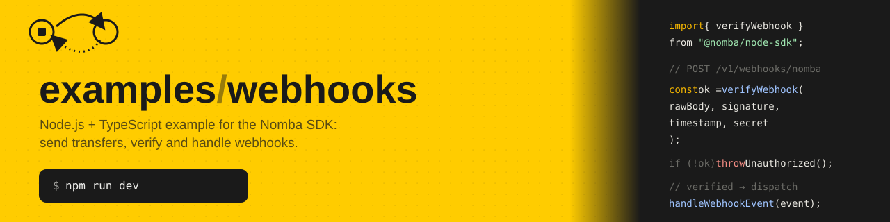

# examples/webhooks

A small Express + TypeScript server for exercising the [`@nomba/node-sdk`](https://developer.nomba.com):
it initiates bank transfers and receives, verifies, and handles the asynchronous
webhooks Nomba sends back about them (success, pending, refund, etc).

For a line-by-line explanation of how the code is organized and how a request
travels through it, see [`docs/walkthrough.md`](docs/walkthrough.md). This
README is the "how do I run and use it" doc.

## Requirements

- **Node.js 24+** — the app runs `.ts` files directly; there is no build step.
  TypeScript is stripped at runtime by Node itself, so no `ts-node`/`tsx` is
  needed. Check with `node --version`.
- A **Nomba sandbox account** with API credentials (account ID, client ID,
  client secret, and a webhook signature key).
- A **public URL** if you want Nomba to actually deliver webhooks to this
  server (e.g. [ngrok](https://ngrok.com) or [cloudflared](https://developers.cloudflare.com/cloudflare-one/connections/connect-networks/))
  — Nomba can't reach `localhost`.

## Setup

1. Install dependencies:

   ```bash
   npm install
   ```

2. Copy the env template and fill in your sandbox credentials:

   ```bash
   cp .env.example .env
   ```

   | Variable | Required | Default | Description |
   | --- | --- | --- | --- |
   | `PORT` | no | `43902` | Port the HTTP server listens on |
   | `NOMBA_ACCOUNT_ID` | yes | — | Your Nomba parent account ID |
   | `NOMBA_CLIENT_ID` | yes | — | API client ID |
   | `NOMBA_CLIENT_SECRET` | yes | — | API client secret |
   | `NOMBA_ENVIRONMENT` | no | `sandbox` | `sandbox` or `production` — must match your credentials |
   | `NOMBA_WEBHOOK_SECRET` | yes | — | The signature key configured on your webhook subscription; used to verify incoming webhooks |
   | `DATABASE_PATH` | no | `./webhooks.db` | Where the local SQLite database file is created — see [Database](#database) |

   Every variable is validated at boot (via `zod` in `src/config/env.config.ts`):
   a missing or malformed value crashes the process immediately with a clear
   error instead of failing later, mid-request.

3. Start the server:

   ```bash
   npm run dev     # restarts on file change (node --watch)
   npm start       # single run, no watch
   ```

On boot the server prints every registered route:

```
[ExampleServer] 12345  - 11/12/2026, 12:00:00 PM     LOG [Bootstrap] Server is running on port 43902
[ExampleServer] 12345  - 11/12/2026, 12:00:00 PM     LOG [Bootstrap] Available routes:
[ExampleServer] 12345  - 11/12/2026, 12:00:00 PM     LOG [Bootstrap]   GET /v1/transfers/banks
[ExampleServer] 12345  - 11/12/2026, 12:00:00 PM     LOG [Bootstrap]   POST /v1/transfers/lookup-bank-account
[ExampleServer] 12345  - 11/12/2026, 12:00:00 PM     LOG [Bootstrap]   POST /v1/transfers
[ExampleServer] 12345  - 11/12/2026, 12:00:00 PM     LOG [Bootstrap]   GET /v1/transfers/:transferId
[ExampleServer] 12345  - 11/12/2026, 12:00:00 PM     LOG [Bootstrap]   POST /v1/webhooks/nomba
[ExampleServer] 12345  - 11/12/2026, 12:00:00 PM     LOG [Bootstrap]   POST /v1/webhooks/repush
```

4. Verify everything typechecks (recommended before committing):

   ```bash
   npm run typecheck
   ```

## Scripts

| Command | What it does |
| --- | --- |
| `npm start` | Runs the server once (`node --env-file=.env src/main.ts`) |
| `npm run dev` | Same, but restarts on file changes (`node --watch`) |
| `npm run typecheck` | Runs `tsc --noEmit` to check types without compiling |
| `npm run test:webhook` | Sends a signed sample `payment_success` event to the running server, to exercise `verifyWebhook` without waiting on Nomba — see [Webhooks](#webhooks) |
| `npm run test:webhook:bad-signature` | Same, but with a tampered signature — confirms the `401` rejection path |
| `npm run db:generate` | Regenerates the SQL migration in `src/database/migrations/` after editing `src/database/schema.ts` — not needed just to run the app |

## Database

Every bank transfer gets a row in a local SQLite database (`DATABASE_PATH`,
default `./webhooks.db`), via [drizzle-orm](https://orm.drizzle.team) on top
of Node's built-in `node:sqlite` — no native dependency, no build step,
matching the rest of this app. Everything related to it lives under
`src/database/`:

- `schema.ts` — two tables: `transfers` (`reference` = the `merchantTxRef` you
  chose, `transactionId` = Nomba's own id once known, `status`,
  `requestPayload`/`responsePayload` as JSON, timestamps) and
  `webhook_deliveries` (every webhook delivery, see below).
- `client.ts` — opens the database and runs any pending migrations from
  `migrations/` on import, so tables exist before the first request. Safe to
  run on every boot.
- `migrations/` — SQL generated by `npm run db:generate`, checked into the
  repo so `npm install && npm run dev` works with no extra step.

**When rows get written:**

- `initiateTransfer` inserts a row once `bankTransfer` resolves — the three
  outcome hooks in [`src/common/transfer.hooks.ts`](src/common/transfer.hooks.ts)
  (the same `TODO`-marked extension point mentioned under
  [Transfer outcomes](#transfer-outcomes)) now persist instead of only
  logging.
- `getTransferDetails` refreshes that row with whatever the requery call
  returns.
- `handleWebhookEvent` updates the matching `transfers` row when a webhook
  arrives — or inserts one if there wasn't a prior local row (e.g. a payout
  event), so nothing delivered is ever dropped. A transfer that resolved
  *pending* has no `transactionId` yet (Nomba only returns `status` for that
  case), so the match is by `merchantTxRef` first — carried in
  `payout_success`/`payout_refund` events — falling back to `transactionId`
  for events that don't carry it. Matching only on `transactionId` would
  miss the pending row and insert a duplicate once the real id arrived.

**Every webhook delivery is also logged**, independent of whether it matched
a transfer: `handleWebhook` in
[`webhook.controller.ts`](src/modules/webhooks/webhook.controller.ts) writes
a `webhook_deliveries` row for every request — accepted or rejected — via
`logDelivery` in
[`webhook.service.ts`](src/modules/webhooks/webhook.service.ts), *before*
checking the signature, so a rejected delivery (`signatureValid: false`,
`status: 'rejected'`) still leaves a durable record of exactly what was
sent, not just a console line that's lost on restart. Once accepted, the row
is marked `status: 'processed'` after `handleWebhookEvent` runs, or
`status: 'failed'` (with the error message) if it throws.

This is deliberately decoupled from the `transfers` table: it's designed so
a future **processor** — a separate worker, cron job, or queue consumer —
could poll `webhook_deliveries` for `status = 'received'` rows and apply
them to `transfers` asynchronously, instead of (or alongside) today's
synchronous call inside the request. No code here does that yet; the schema
and status lifecycle just leave room for it without a later migration.

Note: `drizzle-orm`'s `node:sqlite` driver only exists in the
`1.0.0-rc.5` prerelease line as of this writing (the stable `0.45.x` release
has no `node:sqlite` driver yet) — this app pins both `drizzle-orm` and
`drizzle-kit` to that exact version for that reason.

## API reference

All routes are mounted under the `/v1` prefix.

### `GET /v1/transfers/banks`

Lists the banks usable as a transfer destination.

```bash
curl http://localhost:43902/v1/transfers/banks
```

### `POST /v1/transfers/lookup-bank-account`

Resolves an account number to its account name. Always call this before
`initiateTransfer` to confirm the destination account is valid.

```bash
curl -X POST http://localhost:43902/v1/transfers/lookup-bank-account \
  -H "Content-Type: application/json" \
  -d '{"accountNumber": "1234567890", "bankCode": "044"}'
```

| Field | Type | Rule |
| --- | --- | --- |
| `accountNumber` | string | exactly 10 characters |
| `bankCode` | string | 3–6 characters |

### `POST /v1/transfers`

Initiates a bank transfer.

```bash
curl -X POST http://localhost:43902/v1/transfers \
  -H "Content-Type: application/json" \
  -d '{
    "amount": 1000,
    "accountNumber": "1234567890",
    "accountName": "Jane Doe",
    "bankCode": "044",
    "merchantTxRef": "txn-001"
  }'
```

| Field | Type | Rule |
| --- | --- | --- |
| `amount` | number | positive |
| `accountNumber` | string | exactly 10 characters |
| `accountName` | string | required |
| `bankCode` | string | 3–6 characters |
| `merchantTxRef` | string | required — your idempotency key. Reuse the same value when retrying a *pending* transfer; use a new one only after a transfer has definitively failed or been refunded. |
| `senderName` | string | optional |
| `narration` | string | optional |

The response is whatever the SDK's outcome resolves to (see
[Transfer outcomes](#transfer-outcomes) below).

### `GET /v1/transfers/:transferId`

Looks up a transfer's current status by the `merchantTxRef` you gave it at
creation (there's no separate "transfer ID" — this app doesn't have a list
endpoint either, since the SDK has none to back it).

```bash
curl http://localhost:43902/v1/transfers/txn-001
```

### `POST /v1/webhooks/nomba`

Where Nomba delivers webhook events. Not meant to be called directly — see
[Webhooks](#webhooks) below.

### `POST /v1/webhooks/repush`

Asks Nomba to resend one previously-delivered event — useful after fixing a
bug in the handler, so you don't have to wait for Nomba's own retry window.
Calls `nomba.webhooks.repush()`.

```bash
curl -X POST http://localhost:43902/v1/webhooks/repush \
  -H "Content-Type: application/json" \
  -d '{"hookRequestId": "<id from nomba.webhooks.eventLogs()>"}'
```

| Field | Type | Rule |
| --- | --- | --- |
| `hookRequestId` | string | required — an event log's `hookRequestId`, from `nomba.webhooks.eventLogs()` |

Every successful response is wrapped the same way:

```json
{
  "message": "Request successful",
  "timestamp": "2026-11-12T12:00:00.000Z",
  "status": "success",
  "data": { "...": "..." }
}
```

and every error is wrapped the way NestJS's `ValidationPipe`/`HttpException`
filter does, with a status code that matches the failure (`400` for a bad
request body, `401` for a bad webhook signature, `500` for anything
unexpected):

```json
{
  "statusCode": 400,
  "message": ["hookRequestId Invalid input: expected string, received undefined"],
  "error": "Bad Request"
}
```

## Transfer outcomes

Every money-moving call the SDK makes resolves to exactly one of three
outcomes, and this app's handlers for them live in
[`src/common/transfer.hooks.ts`](src/common/transfer.hooks.ts):

| Outcome | Meaning | What this app currently does |
| --- | --- | --- |
| `success` | Done | Logs it and returns the result |
| `pending` | Not final — still processing, or an undocumented code | Logs it; **wait for the webhook or requery, never retry under a new reference** |
| `failed` | A definite rejection | Logs a warning |

Those hooks only log today — the `TODO` in that file is where you'd plug in
persistence, notifications, or a requery job.

## Webhooks

`POST /v1/webhooks/nomba` verifies the `nomba-signature`/`nomba-timestamp`
headers against `NOMBA_WEBHOOK_SECRET` before doing anything else, using the
SDK's `verifyWebhook`. An invalid signature gets a `401` and the event is
never processed. A valid one is handed to
[`src/modules/webhooks/webhook.service.ts`](src/modules/webhooks/webhook.service.ts),
which currently just logs the event type — same `TODO` situation as the
transfer hooks.

**Important:** this route needs the *raw* request body (bytes exactly as
Nomba signed them) to verify correctly, so it's mounted behind
`express.raw()` instead of the app's normal `express.json()` — see
`src/app.setup.ts` and the walkthrough doc for why.

To receive real webhooks locally:

1. Start a tunnel: `ngrok http 43902` (or your configured `PORT`).
2. In the Nomba dashboard, under **Developer → Webhook Setup**, set the URL
   to `https://<your-tunnel-domain>/v1/webhooks/nomba`, and set the
   signature key to the same value as your `NOMBA_WEBHOOK_SECRET`.
3. Subscribe to the events you care about (e.g. `payout_success`,
   `payout_failed`, `payout_refund`).

Nomba retries failed/missed deliveries on its own. For a manual resend, this
app exposes `POST /v1/webhooks/repush` (see [above](#post-v1webhooksrepush)),
backed by `nomba.webhooks.repush()`; find the `hookRequestId` to repush via
`nomba.webhooks.eventLogs()`, which isn't exposed as a route here but is
available wherever `../nomba.ts`'s client is imported. `nomba.webhooks.replay()`
(resend every matching event in a time window) is also available on the SDK
but not wired up as a route.

### Testing signature verification without a real webhook

`npm run test:webhook` builds a sample `payment_success` event, signs it
exactly the way Nomba does (HMAC-SHA256 of the documented field string,
base64-encoded — see
[`scripts/send-test-webhook.ts`](scripts/send-test-webhook.ts)), and POSTs it
to your running server's `/v1/webhooks/nomba`. Useful for confirming
`verifyWebhook` and your handler work before wiring up a real tunnel:

```bash
npm run dev            # in one terminal
npm run test:webhook   # in another
```

A successful run gets back `{"data": {"received": true}}`. To see the
rejection path instead, run `npm run test:webhook:bad-signature` — it sends
the same event with a deliberately tampered `nomba-signature` and gets back
`401 { "message": "Invalid webhook signature" }`, the same way a wrong or
rotated webhook secret would.

## Project structure

```
drizzle.config.ts                 # points drizzle-kit generate at src/database/
scripts/
└── send-test-webhook.ts          # signs and POSTs a sample event, for local testing
src/
├── main.ts                       # entry point
├── app.setup.ts                  # Express app: middleware + route table
├── config/
│   └── env.config.ts             # validated environment variables
├── database/
│   ├── schema.ts                 # drizzle table definitions (transfers)
│   ├── client.ts                 # opens the db, runs migrations on import
│   └── migrations/               # generated SQL, checked into the repo
├── common/                       # cross-cutting code
│   ├── logger.ts                 # Nest-style console logger
│   ├── request.logger.ts         # logs every request's method/path/status/duration
│   ├── interceptor.response.ts   # shared success/error JSON envelopes
│   ├── validator.request.ts      # zod-validation middleware factory
│   └── transfer.hooks.ts         # success/pending/failed handlers for bankTransfer(), now persisting too
└── modules/                      # one folder per domain
    ├── nomba.ts                  # the shared, configured SDK client
    ├── transfer/
    │   ├── transfer.controller.ts
    │   └── transfer.service.ts
    └── webhooks/
        ├── webhook.controller.ts
        └── webhook.service.ts
```

Each module follows a **controller → service** split: controllers only know
about `req`/`res`, services only know about the Nomba SDK. See
[`docs/walkthrough.md`](docs/walkthrough.md) for the full file-by-file
explanation and a request trace through every layer.

## Logging

Console output is formatted to look like NestJS's default logger (colored
level, pid, timestamp, `[Context]` tag) via the small, dependency-free
`Logger` class in `src/common/logger.ts`. The global error-handling
middleware in `app.setup.ts` logs every unhandled error server-side
(method, path, message, and stack trace) before responding to the client.

Two more things get logged automatically:

- **Every request's timing.** `src/common/request.logger.ts` is mounted
  first in `app.setup.ts`, ahead of the webhook route's raw-body parsing, so
  it wraps every request including `/health` and the webhook endpoint. It
  logs `METHOD url statusCode durationMs` once the response finishes, e.g.
  `[HTTP] POST /v1/webhooks/nomba 200 1.8ms`.
- **The raw webhook payload.** `handleWebhook` in
  `webhook.controller.ts` logs the exact bytes Nomba sent, tagged
  `[Webhook]`, *before* checking the signature — so a rejected delivery
  still leaves a record of what was sent and why it failed.

## Troubleshooting

| Symptom | Likely cause |
| --- | --- |
| Crash on boot with a Zod error | A required env var is missing — check `.env` against the table above |
| `TokenError` on any `/v1/transfers/*` call | Wrong credentials, or `NOMBA_ENVIRONMENT` doesn't match the credential pair (sandbox vs. production) |
| Webhook always gets `401` | The dashboard's signature key and `NOMBA_WEBHOOK_SECRET` don't match, or you restarted the server after changing `.env` without it picking up the new value |
| Webhook never arrives | Check the tunnel is still running and the dashboard URL still points at the current tunnel domain (ngrok's free URLs change on restart) |
| A route 404s | Remember the `/v1` prefix — routes aren't mounted at the bare path |

## License

ISC
